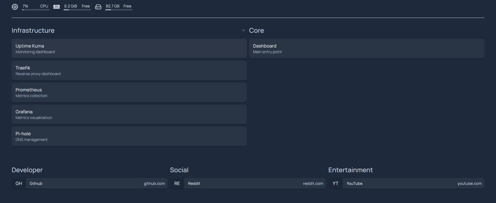
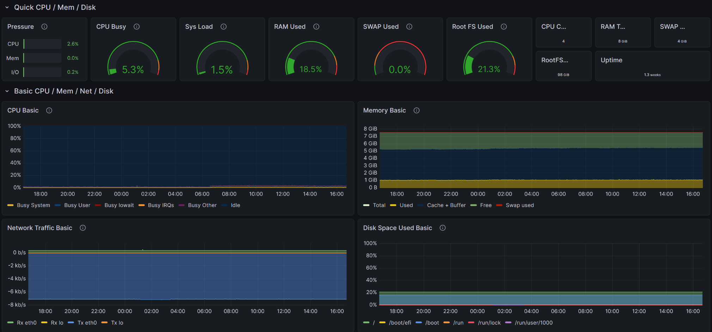
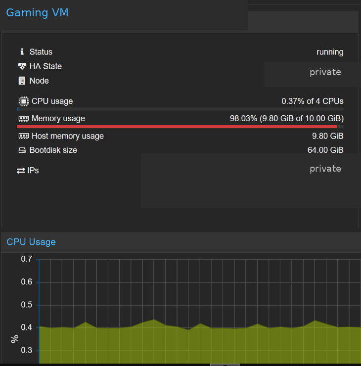
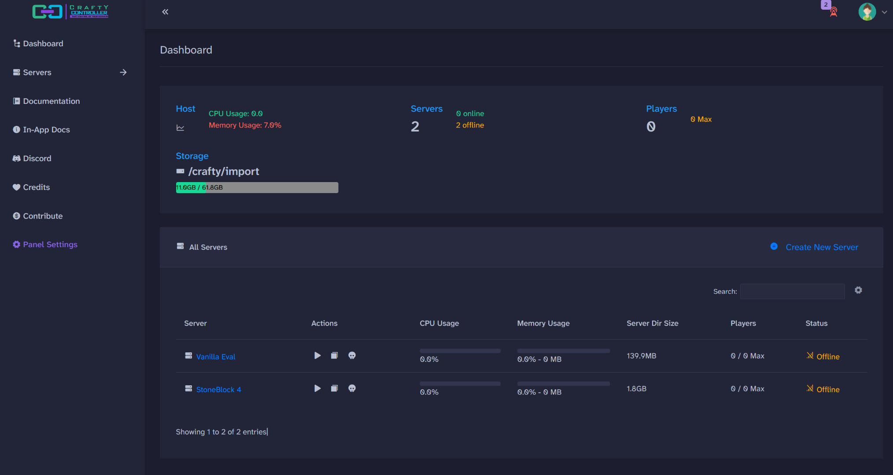

# Homelab

Personal homelab for self-hosting and systems work. I built most of it from
repurposed hardware while studying computer science, and I use it for private
services, monitoring, backups, Minecraft servers, and infrastructure
experiments.

> **Infrastructure baseline: September 23, 2026.** Sahale runtime and backup-job
> observations were verified separately on [October 14, 2026](docs/history/2026-10-14-sahale-observations.yml).
> The October observations do not refresh the full infrastructure inventory.

## Lab at a glance

| System | Hardware / platform | Role |
| --- | --- | --- |
| **Core services** | Lenovo ThinkPad T430 · Ubuntu Server · ~8 GiB RAM | DNS, private ingress, monitoring, Vaultwarden, Homepage, Sahale, backups |
| **Virtualization host** | Ryzen 5 2600 · 16 GiB DDR4 · Proxmox VE · SATA SSD + NVMe | VMs/LXCs, gaming infrastructure, application experiments |
| **Gaming VM** | Debian 12 · Docker · 4 vCPU · 10 GiB RAM | Crafty Controller, Minecraft workloads, game ingress |
| **Admin / development** | ASUS ROG Zephyrus G14 (2024) · Windows 11 + WSL | SSH administration, development, maintenance, local experiments |

More detail: [hardware and roles](docs/hardware.md).

## Architecture

```text
Tailscale private administration
    ├── ThinkPad T430 / Ubuntu Server
    │     ├── Docker services
    │     │     ├── Pi-hole: local DNS / filtering
    │     │     ├── Traefik: private HTTPS -> Vaultwarden / Homepage
    │     │     ├── Prometheus -> Grafana
    │     │     ├── Alloy -> Loki
    │     │     └── Uptime Kuma: reachability checks
    │     ├── systemd: Sahale (Node.js / SQLite)
    │     │     └── private web access via Tailscale Serve
    │     └── Restic -> local backup + encrypted Backblaze B2
    └── Proxmox / Ryzen host
          ├── VMs / LXCs / experiments
          ├── node exporter -> T430 Prometheus
          └── Debian gaming VM / Docker
                ├── Crafty -> Minecraft <- Playit player ingress
                └── scheduled Proxmox backup -> host-local archive
```

The T430 carries the lightweight services I want available most of the time.
The Proxmox host carries VMs, game servers, and experiments that need more
resources or stronger isolation.

Sahale's documented access design uses Tailscale Serve separately from Traefik.
The October checks did not verify live ingress configuration or the deployed
application revision.

[Architecture details](docs/architecture.md)

## Services

- **Networking and access:** Tailscale, Pi-hole, Traefik
- **Observability:** Prometheus, node exporter, Grafana, Loki, Alloy, Uptime Kuma
- **Core services:** Vaultwarden, Homepage, supporting Docker services
- **Personal application:** [Sahale](https://github.com/aidenm727/sahale), a
  systemd-managed Node.js/SQLite application for fitness, career tracking, and
  AI-assisted workflows on the T430
- **Backup:** Restic with local and encrypted Backblaze B2 copies, plus scheduled
  Proxmox VM backups
- **Gaming:** Crafty Controller, Minecraft, Playit

[Full service map](docs/services.md)

## Screenshots

These captures illustrate the September baseline. They show separate moments,
not a synchronized health check or the October Sahale deployment.

### Services and monitoring

<p align="center">
  
  
</p>

*Homepage groups private service links. Grafana shows CPU, memory, network, and
disk measurements from the core-services host during a low-load period.*

### Virtualization and gaming

<p align="center">
  
  
</p>

*Proxmox shows the 10 GiB gaming VM at 98% memory use during the active-workload
period. Crafty shows Vanilla Eval and StoneBlock 4 stopped in a separate capture.
The Proxmox image masks private host and address details.*

## Selected engineering work

### SSH hardening and configuration precedence

A new OpenSSH drop-in specified `PasswordAuthentication no`, while the effective
configuration still reported password authentication enabled. An earlier
cloud-init fragment was taking precedence. I moved the owner policy earlier in
the drop-in order, validated the daemon configuration, confirmed a fresh
key-only login, and confirmed a fresh password login failed.

### Backup and restore testing

The core-services host uses Restic for local and encrypted B2 backups. I have
restored the Vaultwarden database from both paths and checked SQLite integrity on
the restored copy. The Proxmox host also keeps scheduled VM backups for the
gaming VM.

On October 14, Sahale's SQLite snapshot job and the local and off-site Restic
jobs reported successful completion. Those results do not establish that Restic
included the Sahale snapshot or that Sahale can be restored. See the
[dated observations and limits](docs/operations.md#october-14-sahale-observations).

### External exposure testing

For a September 2026 check, I disconnected Tailscale and tested selected
SSH/DNS/HTTP/HTTPS ports from a cellular network. The tested IPv4 paths did not
reach the lab. IPv6 remained unresolved because the external client did not have
a working IPv6 route.

### On-demand game workloads

A modded StoneBlock server accounted for most of the gaming VM's memory use while
it was running. Stopping the server returned the VM to a low idle footprint, so
large game servers stay on demand.

[Operations and reliability](docs/operations.md)

## Gaming

Minecraft is one of the main workloads on the virtualization host. Crafty
Controller runs inside a dedicated Debian VM, administration stays on Tailscale,
and Playit handles player-facing game traffic.

[Gaming infrastructure](docs/gaming.md)

## Remaining reliability work

Verify Sahale snapshot inclusion in Restic and test a Sahale restore. The gaming
VM's Proxmox archives also need an off-host recovery copy to cover host loss.

## Documentation

- [Hardware & roles](docs/hardware.md)
- [Architecture](docs/architecture.md)
- [Services](docs/services.md)
- [Operations & reliability](docs/operations.md)
- [Gaming infrastructure](docs/gaming.md)
- [Selected changes & snapshots](docs/history/)

The public repo omits credentials, private addresses, internal DNS names, exact
management endpoints, and sensitive recovery details. Dated snapshots provide
historical context; live systems determine current state.
